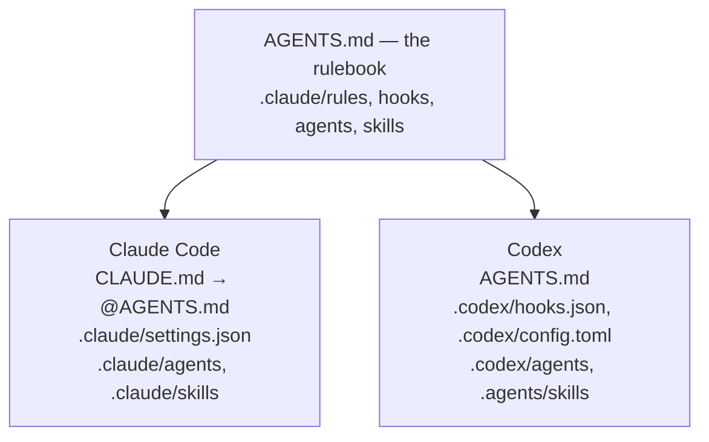

# create-agent-rig

**A maintainable repository setup for AI-assisted development with Claude Code and Codex.**

Rig installs shared instructions, review agents, skills and narrowly scoped hooks
into a new or existing repository. It gives that configuration an explicit
ownership and upgrade lifecycle; your application architecture stays yours.

- **One configuration, both harnesses.** A shared rulebook, guards and review
  agents, delivered in each harness's native format. Capability coverage differs
  by harness; see the compatibility matrix.
- **Upgrades that respect your changes.** Files you edited are reported, not
  overwritten. Files you deleted stay deleted.
- **Guardrails that run, not just rules that are read.** Hooks check specific
  command and edit patterns, including pre-commit bypasses, shared-branch
  force-pushes and credential writes. Their coverage is bounded.
- **Optional integrations, done by the book.** Figma and Atlassian MCP wiring,
  and GitHub Spec Kit through its own pinned CLI.
- **A clean exit.** `doctor` shows what is installed and healthy; `uninstall`
  removes only what Rig can prove it wrote.

Rig configures agent harnesses. It does not generate application code, run
agents, or install plugins.

## Quick start

**Prerequisites: Node.js ≥ 22 and Git**, plus Claude Code or Codex installed and
authenticated separately. No application package manager is required to install
Rig. Start in a clean working tree so you can review the generated changes.

```sh
# a new repository
npx create-agent-rig@latest my-project
cd my-project

# …or an existing one
cd your-repo
npx create-agent-rig@latest init --dry-run   # show what would be written
npx create-agent-rig@latest init
```

Open the repository in your harness:

```sh
claude    # Claude Code reads CLAUDE.md and .claude/settings.json
codex     # Codex reads AGENTS.md, .codex/ and .agents/skills/
```

Finish the project-specific setup before asking an agent to work:

1. Create `.claude/hooks/dod-checks.json` with your real checks, for example
   `["npm test", "npm run lint"]` for a project that defines those scripts.
   Without this file the stop gate has no checks to run.
2. Review the elevated paths in the generated `AGENTS.md` and add the paths in
   your project that require human review.
3. Add `.claude/worktrees/` to your `.gitignore`. With the workflow layer, also
   ignore `.claude/queue.state.json`, `.claude/queue.board`,
   `.claude/gate-rounds.json` and `.claude/runs/`. Put comments on separate lines.
4. Review the generated hooks and the trust prompt described below. Then run:

```sh
npx create-agent-rig@latest doctor
git status --short
# Review and stage the intended files, then commit them.
```

Commit `.claude/.rig-manifest.json` with everything else — it is how later
upgrades tell your changes from Rig's.

Everything is written inside the repository; Rig changes no global Claude Code
or Codex configuration. The only machine-level file it can write is the
optional Memory registration described [below](#memory); Spec Kit setup also
fills uv's download cache.

After generation or upgrade, review the checked-in `.codex/hooks.json` in
Codex's `/hooks` view and explicitly trust it if Codex asks. The
[official Codex hooks documentation](https://learn.chatgpt.com/docs/hooks)
records trust against the current hook hash, so a changed hook definition may
require that review again; Rig never silently replaces hook configuration you
own.

`@latest` resolves the published npm dist-tag; the README on `master` describes
the development tree. A merged feature or frozen release candidate is not proof
that the feature is published. Check the [npm package](https://www.npmjs.com/package/create-agent-rig),
[GitHub releases](https://github.com/serhii-baksheiev/create-agent-rig/releases)
and [changelog](CHANGELOG.md) when selecting a version. Teams can replace
`@latest` in these examples with the exact version they have evaluated.

## Why Rig

Agent instructions tend to rot. A `CLAUDE.md` copied between projects, a
separate set of Codex notes, hooks pasted from a blog post — each drifts on its
own, and none of it can be upgraded without overwriting what the team changed
since.

Rig treats that configuration as something with an owner and a lifecycle:

| Without Rig                                         | With Rig                                                  |
| --------------------------------------------------- | --------------------------------------------------------- |
| Separate Claude Code and Codex setups               | One rulebook, projected into each harness's native format |
| Rules that only work if the agent reads them        | Hooks that reject named patterns at the tool layer        |
| Upgrading means re-copying and losing local changes | `upgrade` updates untouched files and reports the rest    |
| A deleted rule quietly comes back                   | Deleted stays deleted                                     |
| No way to tell what is installed or broken          | `doctor`                                                  |
| Removal is guesswork                                | `uninstall` removes only files Rig can prove it wrote     |

## Claude Code and Codex



`AGENTS.md` is the canonical rulebook. `CLAUDE.md` is a short shim that imports
it, so both harnesses read the same rules. The hook scripts live once in
`.claude/hooks/` and are wired by both `.claude/settings.json` and
`.codex/hooks.json`. Review agents and skills are projected into each harness's
own format.

A repository that already has its own root `CLAUDE.md` keeps it untouched —
Rig installs its shim nested at `.claude/CLAUDE.md` instead, and Claude Code
loads both files (measured, not assumed: see
[`docs/decisions/agents-md-canonical.md`](docs/decisions/agents-md-canonical.md),
"CLAUDE.md coexistence — measured (RP-256 slice 1)").

The harnesses are not identical, and Rig does not pretend they are. Two hooks —
the subagent model guard and the routing warning — exist only for Claude Code.
MCP wiring goes into Claude Code's `.mcp.json` entry by entry, but into Codex's
`.codex/config.toml` as a whole file Rig renders.

## What Rig installs

| Area               | What you get                                                                                                                                                                                                                             |
| ------------------ | ---------------------------------------------------------------------------------------------------------------------------------------------------------------------------------------------------------------------------------------- |
| Rules              | `AGENTS.md`, `CLAUDE.md` and `.claude/rules/`: autonomy tiers (what an agent may do alone), stop rules, TDD workflow and a Definition of Done                                                                                            |
| Guards             | Hooks that refuse bypassing pre-commit, force-pushing a shared branch, destructive `rm`, writing credentials, and ending a session while a configured check is red                                                                       |
| Agents             | `test-writer` and `implementation-agent` for the TDD steps; `code-reviewer`, `security-scanner` and `prose-reviewer` for review; `failure-diagnostician` to reproduce a failure or a claimed finding — each pinned to a model and effort |
| Skills             | `worktree-task`, `new-invariant`, `check-premises`, `skill-authoring` and `diagnose`                                                                                                                                                     |
| Lifecycle metadata | `.claude/.rig-manifest.json`: which bytes Rig installed                                                                                                                                                                                  |

A guard is a check on each edit or command before it runs, not a sandbox. Each
one states what it does not catch in its own header — `guard-secret-file`, for
example, sees what an agent writes through its edit tools, not a file committed
from disk. `guard-bash` in particular is not general command isolation or a
sandbox: it refuses only the specific shapes it names — git, credential,
deploy and destructive-delete cases. General OS/process isolation is the
harness's own native sandbox setting
(Claude Code / Codex sandboxing), not guard-bash's job.

Two things are left for you, and the installed `AGENTS.md` says so: the
commands your Definition of Done should run (`.claude/hooks/dod-checks.json`),
and the paths in your project that need a human reviewer.

An **experimental**, opt-in workflow layer adds queue-driven loop instructions,
a pre-merge gate skill and PR-lifecycle helpers:

```sh
npx create-agent-rig@latest init --layer workflow --dry-run
npx create-agent-rig@latest init --layer workflow
```

The harness session executes these skills; Rig is not a background service.
Queue claims and dependency checks coordinate cooperating controllers and are
advisory, not a distributed lock or a guarantee against duplicate work. Review
tracker credentials, decision authority, sandbox settings and stop conditions
before an unattended session. The [unattended execution contract](docs/unattended-execution.md)
distinguishes tool enforcement from instructions and operator responsibilities.

For a Spec Kit plan shared by several controllers, Rig can project
`specs/<feature>/tasks.md` into GitHub Issues and use the existing queue to
read dependencies and claims. See [Parallel Workflows](docs/parallel-workflows.md)
for the import command, re-import behavior and current concurrency limits.

## Working with a rig

Start with bounded, attended work. These are example prompts to your harness,
not CLI commands or guaranteed outcomes:

> Reproduce the reported validation bug in this repository. Ask the test-writer
> to establish a failing regression test, then use the implementation-agent for
> the smallest fix. Run the configured checks and obtain independent review.

> Review this branch against the project Definition of Done. Reproduce each
> actionable finding before changing code, and report the remaining risks.

> Use the worktree-task skill for this isolated change. Confirm file ownership
> and scope before editing; stop if another controller owns the same work.

The agents provide roles and review instructions; their names do not establish
that a review ran or that its conclusion is correct. Inspect the actual changes,
test output and review findings before merging.

## How ownership works

Rig remembers exactly which bytes it installed. That lets every lifecycle
command tell Rig's files from yours:

| The file is…                | `upgrade`                    | `uninstall`    |
| --------------------------- | ---------------------------- | -------------- |
| exactly as Rig installed it | updated to the new release   | removed        |
| edited by you               | kept, reported as a conflict | kept, reported |
| deleted by you              | stays deleted                | nothing to do  |
| not Rig's, or there before  | never claimed                | never touched  |
| `PLAN.md`                   | never touched, either way    | kept, reported |

Conflicts are reported with the path to the new version, so you can compare
and merge yourself — Rig does no automatic merging of the documents your agents
obey. `PLAN.md` is the one **seed-once** exception to the table above: Rig
writes it once, on the first `init`, and it is yours from that moment —
pristine or edited, `upgrade` never diffs or rewrites it and `uninstall`
preserves it, reported the same way an edited file is. One exception: a
manifest written by a release that predates seed-once `PLAN.md` still records
it as an ordinary file until `init` or `upgrade` runs once, and `uninstall`
on that older record removes an unedited `PLAN.md`. The details,
including how line endings and hook wiring are handled, are in
[`docs/command-contract.md`](docs/command-contract.md) and
[`docs/decisions/raw-byte-ownership.md`](docs/decisions/raw-byte-ownership.md).

## Lifecycle

**Upgrade** to the current release:

```sh
npx create-agent-rig@latest upgrade --dry-run   # the plan, nothing written
npx create-agent-rig@latest upgrade             # the plan, then asks before writing
npx create-agent-rig@latest upgrade --yes       # no prompt (required off a terminal)
```

**Diagnose** the repository:

```sh
npx create-agent-rig@latest doctor
npx create-agent-rig@latest doctor --json
```

`doctor` checks the Rig manifest and the files it lists, the installed guards,
the optional workflow layer, integration wiring, Spec Kit's own offline status
and the Memory registration. It exits `1` only when a check fails. It reports
wiring, not reachability: it never contacts a provider, and never claims that
authorization, connectivity or trust were verified.

It also carries two personal-machine onboarding diagnostics that never affect
the exit code: a presence-only check of the tracker credential environment
variable names your `.claude/queue.json` adapter needs, and — only when this
repository has checked-in Codex hook wiring — a pointer to Codex's own
`/hooks` view to review and trust it.

**Uninstall**, keeping everything you wrote:

```sh
npx create-agent-rig@latest uninstall --dry-run
npx create-agent-rig@latest uninstall
```

Only files whose bytes still match what Rig installed are removed. Anything
edited is kept and listed — and so is `PLAN.md`, pristine or edited, since
it was never Rig's to begin with once seeded (an older manifest is the
exception above). A kept file does not hold the
manifest back on its own; the manifest stays only while something else is
still owned and unremoved. `--detach` removes the manifest anyway and hands
the kept files over to you. Integration wiring is removed with `setup
remove`, not `uninstall`.

## Optional integrations

`setup` adds integrations after showing the exact plan and asking for
consent. It works in a repository where Rig is installed:

```sh
npx create-agent-rig@latest setup                  # interactive: pick provider and harness
npx create-agent-rig@latest setup list
npx create-agent-rig@latest setup add figma-mcp --harness claude-code --harness codex
npx create-agent-rig@latest setup apply            # re-apply everything declared
npx create-agent-rig@latest setup remove figma-mcp
```

`add`, `apply` and `remove` accept `--dry-run`. With `--json` they never
prompt, and write only with `--yes`. Intent and ownership are recorded in `.rig/integrations.json`.

The table distinguishes the development tree from the published package audited
on **2026-10-11** (`npm latest`: **1.5.1**). Run `setup list` with your selected
version to check its actual registry; do not assume a `master` integration is
available through `@latest`.

| Integration     | ID               | Availability                                | What Rig does                                                                                   |
| --------------- | ---------------- | ------------------------------------------- | ----------------------------------------------------------------------------------------------- |
| Figma MCP       | `figma-mcp`      | npm 1.5.1 and master                        | Writes the hosted MCP entry for Claude Code and/or Codex                                        |
| Atlassian MCP   | `atlassian-mcp`  | npm 1.5.1 and master                        | Writes Atlassian's hosted MCP entry                                                             |
| Playwright MCP  | `playwright-mcp` | master only; absent from audited npm latest | Wires `npx @playwright/mcp@0.0.83` for attended browser verification; vendors nothing           |
| Basic Memory    | `basic-memory`   | npm 1.5.1 and master; preview               | Wires `uvx basic-memory mcp`; never installs, reads or removes its data                         |
| GitHub Spec Kit | `spec-kit`       | npm 1.5.1 and master                        | Delegates lifecycle to the official CLI pinned to 1.0.8                                         |
| Probity         | `probity`        | npm 1.5.1 and master                        | Hands covered edit calls to the project-local `@nizos/probity` 1.10.1 launcher                  |
| BMAD TEA        | `bmad-tea`       | master only; absent from audited npm latest | Recognizes BMAD TEA 1.27.2 install state; never installs it. Outputs are advisory evidence only |

**MCP wiring is owned by Rig.** Rig writes the entries and removes only the ones
it can prove it wrote; your own MCP entries are preserved. Signing in to a
provider happens in the harness — Rig stores no credentials.

**Spec Kit is owned by Spec Kit.** Rig runs the official `specify` CLI at a
pinned version through `uvx` — so `uv`, `uvx` and `git` are required — and
Spec Kit creates, upgrades and removes its own files. Rig never copies or
deletes them. The first setup needs a clean working tree and never re-runs
`init` on an already initialized repository; an existing installation is
adopted with `setup add spec-kit --adopt`.

**Probity is owned by Probity.** Install `@nizos/probity` 1.10.1 as a dev
dependency yourself; Rig never installs it, and `setup` and `doctor` never run
it. `setup add probity` writes a `probity.config.mjs` only when you have none
(use `--adopt` to keep yours). Once Probity is selected, Rig's
`probity-gate` hook hands Claude Code's `Write`, `Edit` and `NotebookEdit`
calls and Codex's `apply_patch`, `Edit` and `Write` calls to the project's
Probity launcher; `MultiEdit` and shell commands are not handed over.
Probity's config decides which of those writes must follow test-first. `doctor` reports the wiring but cannot
see whether Probity is answering. Inside a Claude Code subagent, Probity judges
an edit against the parent session's transcript, an upstream behaviour Rig
does not work around (`docs/decisions/discipline-providers.md`, § Probity).

**Playwright and BMAD TEA provide evidence, not release authority.** Playwright
MCP is intended for attended browser verification. BMAD TEA is an upstream-owned
methodology integration; attaching either tool's output cannot independently
produce a Rig SHIP or HOLD verdict. See [artifact evidence](docs/decisions/artifact-evidence.md).

**Plugins are not managed.** Rig has no plugin manager or marketplace.
Superpowers orchestration skills (`subagent-driven-development`,
`dispatching-parallel-agents`, `executing-plans`) are **unsupported inside a Rig
loop run**: they introduce another scheduler. Orthogonal methodology skills
beside an attended session are **UNVERIFIED**, as is Superpowers support in
Codex. Rig cannot disable individual Superpowers skills; this boundary is an
operator rule, not an enforcement mechanism. See [discipline providers](docs/decisions/discipline-providers.md).

## Memory

Memory is a separate project with its own releases. Rig does not include it,
does not need it, and never searches for it. If you use Memory, register it
once per machine; Rig then passes `doctor` and `load` through to it after a
version handshake:

```sh
npx create-agent-rig@latest setup --memory-root <memory-checkout>
npx create-agent-rig@latest memory doctor --json
npx create-agent-rig@latest memory load --json --cwd .
```

The registration is written to `~/.config/create-agent-rig/subsystems.json`
(`%APPDATA%\create-agent-rig\` on Windows). A Memory with an incompatible
contract version is refused with exit code `4`. The boundary is described in
[`docs/decisions/memory-rig-boundary.md`](docs/decisions/memory-rig-boundary.md).

## Safe by default

- **Ownership, not guesswork.** Rig changes or removes only files whose bytes
  match what it installed.
- **Conflicts over overwrites.** Your edits are reported, never merged or
  replaced.
- **Deleted stays deleted.** An upgrade does not restore what you removed.
- **Plan first.** `--dry-run` shows the plan for `init`, `upgrade`, `uninstall`
  and `setup`; `upgrade`, `uninstall` and `setup` also ask before writing.
- **Bounded external processes.** Spec Kit runs with a fixed argument list, a
  deadline, and cleanup of its whole process tree.
- **No stored credentials.** Rig does not put provider credentials in the
  repository, its state files or its output.

## Platform support

| Platform | Evidence boundary                                                                                 |
| -------- | ------------------------------------------------------------------------------------------------- |
| Linux    | Covered by repository tests and release acceptance tooling; verify the exact candidate's results. |
| Windows  | Covered by native test and acceptance paths; review the Spec Kit caveat below.                    |
| macOS    | Apple silicon has a release acceptance path; verify the exact candidate's results.                |

These paths are not a blanket compatibility guarantee. Individual wiring and
third-party combinations may remain **UNVERIFIED**, even when a platform's
other checks pass. The [compatibility matrix](docs/compatibility.md) records
capability-level status and evidence; provider login, network access and native
harness behavior require checks in your own environment.

On Windows, Spec Kit 1.0.8 rewrites `.claude/settings.json` and
`.codex/config.toml` with CRLF line endings. `doctor` then reports Rig's files
with a warning, and where a Codex MCP integration is also wired, a later change
to it asks you to merge the Codex config by hand instead of overwriting it.

## Limitations and non-goals

- No application scaffolding, no project templates to choose from.
- Not an agent runtime, scheduler or workflow engine; it configures the
  harnesses you already run.
- No plugin manager, and no bundled memory engine.
- Provider accounts, authorization and connectivity are between you, the
  provider and the harness.
- The workflow layer is experimental.

No combination of instructions, hooks or reviewers proves autonomous correctness
or comprehensive security. Shell indirection, tools outside hook coverage and
manual changes remain outside some checks. Keep native sandboxing and explicit
human authority appropriate to your repository. `doctor` verifies local state,
not successful provider execution.

## The 2-minute demo

From a clone of this repository:

```sh
./demo.sh
```

It installs the rig into a scratch directory and shows a hook refusing an
attempted pre-commit bypass.

## Requirements

- Node ≥ 22. The CLI has no runtime dependencies.
- Git.
- For Spec Kit only: `uv` and `uvx`.

## Documentation

| Document                                                       | Covers                                                                         |
| -------------------------------------------------------------- | ------------------------------------------------------------------------------ |
| [`docs/command-contract.md`](docs/command-contract.md)         | Every command's options, output, exit codes and ownership rules                |
| [`CHANGELOG.md`](CHANGELOG.md)                                 | What changed in each release, and the release checklist                        |
| [`docs/decisions/`](docs/decisions/)                           | Design decisions: ownership, `AGENTS.md`, Codex adapter, integrations          |
| [`docs/compatibility.md`](docs/compatibility.md)               | What each capability does per harness and platform                             |
| [`docs/releasing.md`](docs/releasing.md)                       | How a release is prepared and accepted                                         |
| [`docs/parallel-workflows.md`](docs/parallel-workflows.md)     | Spec Kit task import, tracker dependencies and controller boundaries           |
| [`docs/unattended-execution.md`](docs/unattended-execution.md) | What Rig enforces, verifies and leaves to the harness when a run is unattended |

## Release and CI contracts

Ordinary CI tests fixtures, ownership, projections and command contracts. It
does not by itself establish a published release or live integration acceptance.
The [release procedure](docs/releasing.md) defines the separate, opt-in packed
artifact acceptance lane for an exact commit, including frozen candidate
handling. [Command contracts](docs/command-contract.md) define observable CLI
behavior, exit codes and the evidence behind README promises. Publication is an
owner action; a green PR is not permission to publish.

## Development

```sh
pnpm install
pnpm test          # build and the full suite
pnpm test:unit     # the fast suite
pnpm lint
pnpm typecheck
```

This repository uses its own rig: changes go through a branch, tests first, and
review before merge. [`AGENTS.md`](AGENTS.md) is the working agreement.

## License

[MIT](LICENSE)
